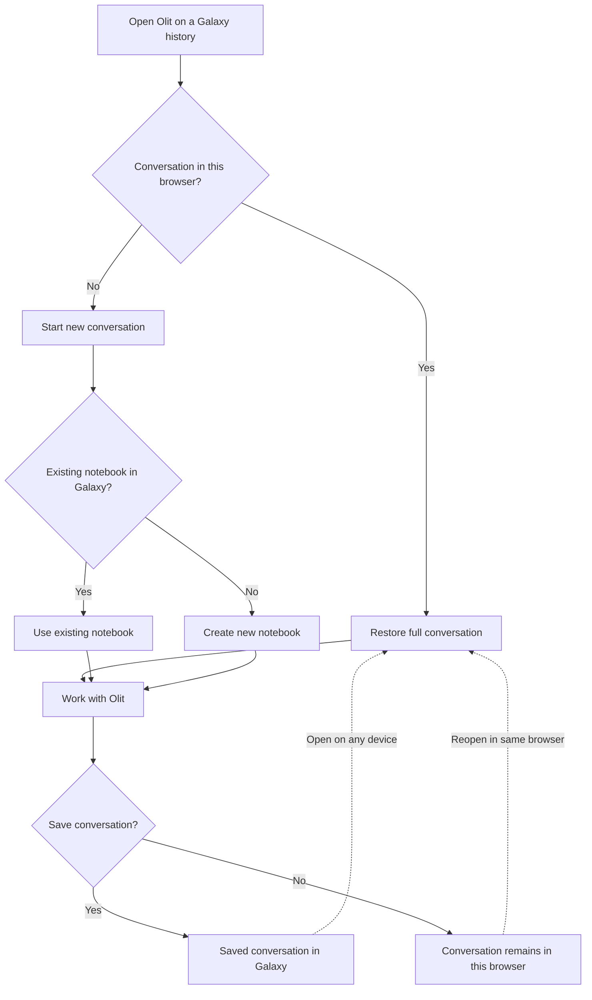

# olit-guide

Orbit Lite (Olit) is an AI research assistant built directly into the Galaxy platform. It allows researchers to analyze data, run tools, build charts, and document experiments using plain language.

---

## 1. Orbit vs. Olit

Galaxy provides two complementary AI assistants within its ecosystem:

* **Orbit** lives in the Galaxy core, operating with full system-level access and broader backend capabilities.
* **Olit** lives entirely in the browser, providing an instant assistant directly inside the web interface.

Throughout this document, Orbit Lite is referred to simply as **Olit**.

---

## 2. Execution Environments
Orbit and Olit use fundamentally different execution models:

* **Orbit uses Linux and Bash:** It operates on a standard Linux environment with full command-line terminal access. It can install packages, run shell scripts, and execute tasks outside Galaxy.
* **Olit uses Galaxy and Pyodide:** It has no operating system or terminal access. It interacts with data strictly through Galaxy APIs and runs Python in the browser via Pyodide.

### Key Implications:
1. **Olit Cannot Patch Missing Galaxy Features:** If a tool, dependency, or reference genome is missing on the Galaxy server, Olit cannot install it.
2. **Highlighting Gaps in Galaxy:** Because Olit cannot work around missing capabilities using system commands, it directly exposes what Galaxy lacks. This makes Olit a valuable tool for uncovering Galaxy's gaps.
3. **Pyodide Limitations:**
   * **Lightweight Only:** Browser-based Python handles only basic data checks, column filtering, and quick math.
   * **Browser Sandbox:** It has no access to local files and operates under standard browser security.
   * **Heavy Science Stays in Galaxy:** All heavy computational workloads must run as real Galaxy tools, not in the browser.

---

## 3. Resumability

Because the browser owns the agent, Olit provides automatic session recovery across devices:

* **Same Browser:** If you reopen the tab, the conversation history is immediately restored from local browser storage.
* **Across Devices:** If you save the conversation, Galaxy stores it as a visualization object that can be reopened from any machine.
* **Notebook Persistence:** Starting a new conversation automatically reconnects to an existing Galaxy notebook if one is already attached to that history.

---

## 4. How It Works

Olit ensures you retain full control over your analysis:

1. **Step-by-Step Plan:** Olit proposes a concrete plan listing tools and parameters before executing anything.
2. **User Review:** You can review, adjust, or approve the proposal.
3. **Execution on Approval:** Galaxy tools are submitted only after explicit confirmation.
4. **Progress Tracking:** Olit tracks job completion in the background and reports results.

---

## 5. Key Capabilities

* **Run Galaxy Tools:** Discovers installed tools, configures inputs, and executes jobs.
* **Run Workflows:** Imports and runs verified community workflows.
* **Import Public Data:** Downloads sequencing data from public archives like ENA by accession number.
* **Consult Tutorials:** Reads Galaxy Training Network tutorials to follow verified scientific protocols.
* **Organize Histories:** Groups, renames, and tags datasets.

---

## 6. Visualizations and Charts

* **Built-in Galaxy Viewers:** Opens dedicated Galaxy visualizers (such as genome browsers or molecular viewers) with pre-loaded data.
* **Custom Charts:** Generates interactive bar charts, scatter plots, and heatmaps for tabular data directly in the side panel.
* **Save vs. Preview:** Lets you preview charts temporarily or save them permanently to your Galaxy account.

---

## 7. Built-in Skills

Instead of guessing platform conventions, Olit references built-in skills:
* **Specific Knowledge:** Covers chart configuration, collection management, and notebook formatting.
* **Loaded on Demand:** Consulted only when a matching task begins.
* **Fixed Rules:** Locked into the package in advance to guarantee predictable behavior.

---

## 8. Lab Records

Chat conversations can easily be lost. Olit automatically maintains a permanent Galaxy Page for every project:
* **The Plan:** Records the approved goals and parameters.
* **The Execution:** Logs the tools used, marking completed steps with checkmarks.
* **The Output:** Embeds generated charts directly into the document.
* **Durable Deliverable:** Leaves behind a complete and shareable scientific notebook at the end of every session.

---

## 9. Safety and Governance

* **Destructive Action Warnings:** Prompts for explicit confirmation before deleting datasets or canceling workflows.
* **Reproducible Computations:** Performs all scientific transformations through real Galaxy tools with full provenance tracking.
